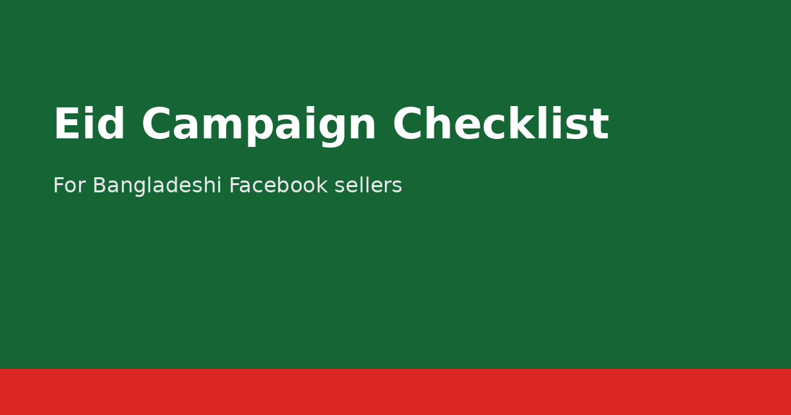

# Eid Campaign Checklist for Bangladeshi Facebook Sellers

*By [MD Fozla Rabbi](https://mdfozlarabbi.smartstyledecor.com), SEO Specialist*

For most F-commerce pages in Bangladesh, Eid is the Super Bowl. A big chunk of the year's sales can land in a few weeks. And every year, sellers lose orders to the same avoidable problems. Late posts. Slow inbox. Courier cut-offs nobody announced.

So here's a checklist. Print it. Stick it on the wall. Tick it off.

## 4 weeks before Eid

- **Lock your stock.** Know what you can actually deliver. Overselling then cancelling destroys trust.
- **Plan 3 hero products.** Don't promote 50 items equally. Pick the 3 most likely to sell and build around them.
- **Shoot content in one go.** Photos on a model or flat-lay, short try-on videos, a packing video. Natural light. Clean background.
- **Clean up your page.** New cover photo with Eid collection. Updated "About" with delivery areas and payment options (bKash, Nagad, COD).
- **Check your social proof.** A page with very few likes or followers looks risky during the busiest season. If you're thin, build a modest base now, gradually, not the week before Eid.

## 3 weeks before Eid

- **Start posting the collection.** One hero product per day, rotating.
- **Post customer photos** from last Eid if you have them. Real people wearing your products sell harder than models.
- **Set up Messenger quick replies.** Price, sizes, delivery charge, delivery time. Answer the top 5 questions in one tap.
- **Start small boosts** on posts that get organic comments. ৳300–৳500 each, targeted to your delivery areas.

## 2 weeks before Eid

- **Go live.** Evenings after Iftar get big audiences during Ramadan. Show products, answer questions live.
- **Announce courier cut-off dates.** "Order by X date for delivery before Eid in Dhaka. Y date for outside Dhaka." Pin it.
- **Push your best-performing post** with a bigger boost. Proven posts only.
- **Add reactions on hero posts** if they look quiet compared to their reach. Empty-looking posts get skipped.

## Final week

- **Daily stock updates.** "Only 5 left in size M." Honest scarcity works.
- **Reply to every message within an hour.** Assign someone if you can't. This is where most orders are won or lost.
- **Post order confirmation screenshots** (with customer details hidden) to show demand.
- **Stop promoting items that won't arrive in time.** Shift to "after-Eid delivery" offers instead.

## After Eid

- **Thank customers publicly.** A simple post builds loyalty.
- **Ask for photos and reviews.** This is next year's social proof.
- **Write down what sold and what didn't.** Next Eid starts here.

## Social proof without the risk

A lot of sellers ask whether buying likes before Eid is a good idea. Done carefully, it can help a page look trusted during a season when buyers compare many pages fast. The rules are simple: start weeks early, go gradual, never share your password and keep posting real content.

For the details, including page likes vs post likes and current Taka pricing, SMM Booster BD has a guide on [buying Facebook likes in Bangladesh safely](https://smmbooster.bd/blog/buy-facebook-likes-in-bangladesh). And their full [Facebook services list](https://smmbooster.bd/services) takes bKash.

## The one-line version

Prep early. Pick 3 hero products. Reply fast. Announce cut-offs. Boost winners. Eid rewards the organised seller, not the loudest one.

---

*More notes: [Bangla YouTube channel setup checklist](bangladesh-youtube-channel-setup.html) · [Free Instagram views in Bangladesh](bangladesh-instagram-free-views.html)*
