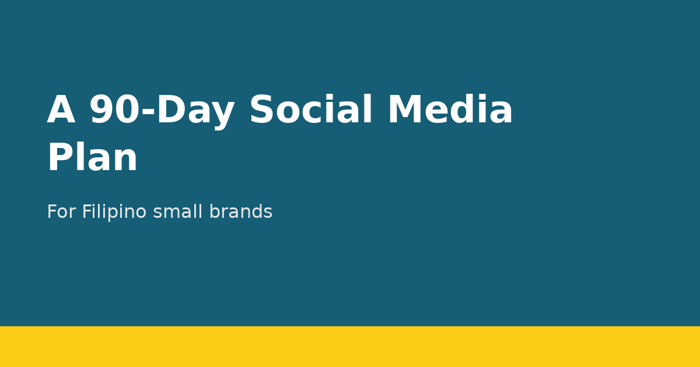

# A 90-Day Social Media Plan for Filipino Small Brands

*By [MD Fozla Rabbi](https://mdfozlarabbi.smartstyledecor.com), SEO Specialist*

Most small brands in the Philippines don't fail at social media because of bad content. They fail because they stop. Two great weeks, then the shop gets busy, then nothing for a month. The page goes quiet. The algorithm forgets you.

A 90-day plan fixes that. It's long enough to see real results and short enough to actually finish. Here's one I've seen work for food stalls, online boutiques and small service businesses.

## Before day 1: pick one main platform

Don't try to master four apps at once.

- **Facebook** if your customers are local or older than 25. Still the biggest in PH.
- **TikTok** if you sell products that look good in motion. Food, beauty, gadgets.
- **Instagram** if your brand is visual and your buyers are younger and urban.

Post the same content to the others if you like. But plan for one.

## Days 1–30: foundation month

The goal is a page that looks alive and trustworthy.

- **Fix the profile.** Clear logo, cover photo showing your product, short bio with location and how to order.
- **Turn on Messenger auto-reply.** "Hi po! Thanks for messaging. We'll reply within 1 hour." Filipinos expect fast replies.
- **Post 4–5 times a week.** Mix product photos, short videos, behind-the-scenes and one customer story.
- **Save your best 10 posts in a folder.** You'll reuse them.
- **Ask every buyer for a photo or review.** This becomes your social proof library.

If the page is brand new, a small, gradual starting base of followers can help it not look empty while you build. Keep it modest. Real posts still matter most.

## Days 31–60: rhythm month

Now you find what works.

- **Check insights every Sunday.** Which 3 posts got the most shares, saves or messages?
- **Make more of the winners.** Same angle, new photo. Same hook, new product.
- **Go live once a week.** Payday weekends work best. The 15th and 30th.
- **Start small boosts.** ₱150–₱300 on your best organic post, "messages" as the goal, tight location.
- **Join 3 local or niche groups.** Share helpful posts, not spam.

## Days 61–90: growth month

You know your audience now. Push harder on what works.

- **Raise boost budget only on proven posts.** Never on new untested ones.
- **Try one collab.** A local creator or a non-competing shop. Swap shoutouts.
- **Run one promo.** "Free delivery this payday" or a bundle. Something easy to share.
- **Batch content.** Shoot two weeks of videos in one afternoon so busy days don't break the rhythm.

## What to measure

Forget vanity metrics. Track these monthly:

- Messages and enquiries from social
- Orders that came from social (ask "saan mo kami nakita?")
- Cost per message on boosts
- Top 3 posts by shares and saves
- Follower growth (last, not first)

If messages and orders grow, the plan is working even if follower count is slow.

## Common traps

- **Posting only promos.** People follow for value. Mix in tips, stories and fun.
- **Ignoring comments.** Every reply is free reach.
- **Boosting everything.** Boost winners only.
- **Quitting at day 40.** Results often show between day 45 and 75. Push through.

## Want the full strategy?

This plan is the short version. For the complete picture, including platform choice, content pillars and growth tactics written for the Philippine market, BoostingPH has a detailed [social media marketing strategy and growth guide](https://boostingph.com/blog/social-media-marketing-complete-strategy-and-growth-guide).

And if you need that early social-proof push while you build, [BoostingPH](https://boostingph.com/) lists peso rates for followers, likes and views.

Ninety days. One main platform. Show up consistently. That's honestly most of it.

---

*More notes: [Facebook group growth in the Philippines](philippines-facebook-group-growth.html) · [TikTok affiliate in the Philippines](philippines-tiktok-affiliate.html)*
